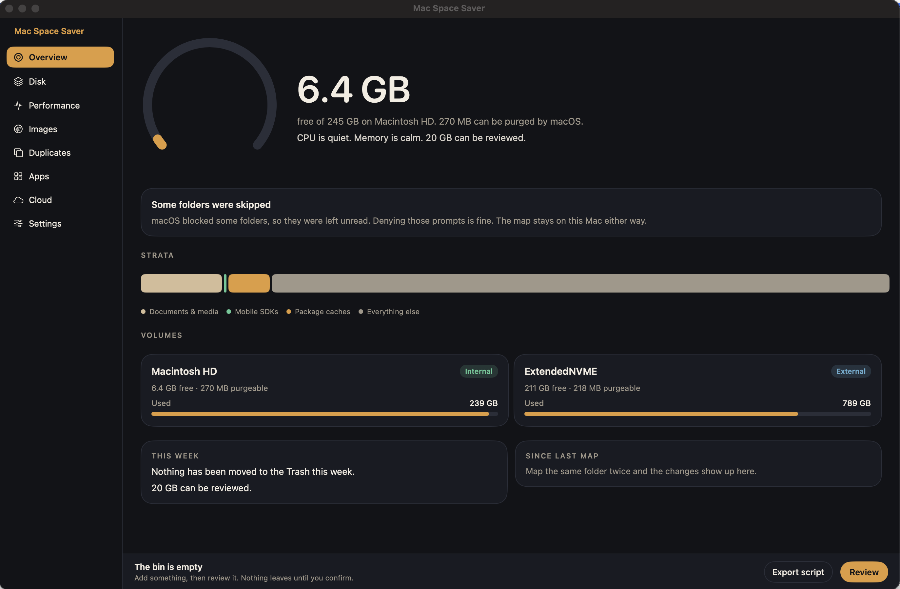
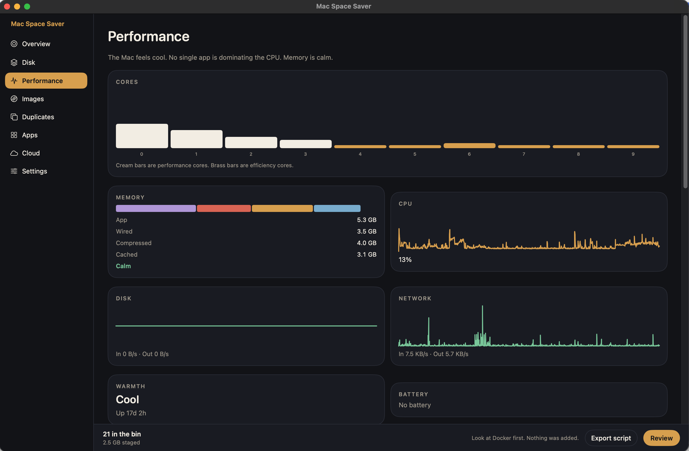

# Mac Space Saver

Mac Space Saver is a native macOS menu-bar desk for storage and performance. It lives in the menu bar, opens into a full window, and shows free space, a folder map, CPU and memory, OS images, duplicate files, installed apps, and the local footprint of cloud folders. It can also keep the Mac from idle-sleep while an agent or another background job is running.

It does not have an account, a network call, or telemetry. Maps, settings, and the cleanup log stay on the Mac. The running app never uploads a file, a path, a hash, or a screenshot.



*Overview. Free space, volumes, and a note when macOS leaves a protected folder unread.*



*Performance. Cores, memory, CPU, disk, and local interface totals. These numbers are read on this Mac.*

The pictures live in `Screenshots/` in this repository. They are static files for the README. The app does not send them anywhere.

## Files, permissions, and what stays offline

Mac Space Saver is offline. There is no account, no server, and no network client in the app. Nothing is sent online: not a folder map, not file names, not file bytes, not a hash, and not a permission you grant.

macOS may still show its own permission dialogs. Those dialogs stay on this Mac. Allowing one does not contact Apple or anyone else from this app. Denying one leaves that folder out of the map.

| What you do | What the app reads | Where it stays |
| --- | --- | --- |
| Map home, or choose a folder | Folder names and allocated sizes. File contents are not opened. Symlinks are not followed onto another volume. iCloud placeholders are not downloaded. | `~/Library/Application Support/Mac Space Saver` on this Mac |
| Deny a Documents, Desktop, Downloads, or Photos prompt | That folder is skipped. The overview says the map was partial. | Nowhere. The folder is not listed. |
| Allow that prompt | Names and sizes in that folder can appear in the map. | The same local Application Support folder. Revoke it later in System Settings → Privacy & Security. |
| Duplicate search | File bytes, only inside folders you pick, hashed on this Mac. Placeholders that are not downloaded are skipped. | The hash is kept in memory for that search. The bytes are not stored and are not uploaded. |
| Cloud page | Local size of iCloud Drive, CloudStorage, and a Google Drive cache, if those folders are already on the Mac. | On screen. There is no delete control and no download. |
| Apps page | App name, bundle id, and size from `/Applications` and `~/Applications`. | On screen. Apple's own apps are hidden. |
| Images page | Local installer files, Android image folders, and, only if you press **Look at Docker**, the local Docker image list. | On screen until you add something to the bin and confirm. |
| Export script | The paths you already confirmed. | A zsh file you save yourself. The app does not run it and does not upload it. |
| Allow alerts | Nothing from your disk. | A local notification permission. Notices are delivered on this Mac. |
| Stay awake | Nothing from your disk. | A local power assertion. It ends when the timer ends, you turn it off, or the app quits. |
| Open at login | Nothing from your disk. | A login item registered on this Mac. |

Full Disk Access is not required. The app does not ask you to turn it on.

Personal folders stay off the cleanup list even when a map was allowed to measure them. Documents, Desktop, Pictures, Movies, Music, Mail, Messages, Photos, keychains, containers, cloud storage, `.git`, and system roots are refused again at removal time. Files that do pass the check go to the Trash only after you confirm.

Paths drawn in the desk use `~/…` for anything inside your home folder. The account name is not part of the source. A removal still uses the real path, and that path stays on this Mac unless you export a script yourself.

This repository contains the source, the tests, the icon, and the two screenshots above. It does not contain a saved map, a cleanup log, or a listing of a home folder. Tests use fixture paths under `/Users/ada`.

## Install

You need macOS 14 or later and the Swift command-line tools (`xcode-select --install` if `swift` is missing). Xcode itself is optional.

```bash
git clone https://github.com/t-teja/Mac-dashboard.git
cd Mac-dashboard
swift test
zsh scripts/bundle.sh
open "build/Mac Space Saver.app"
```

`scripts/bundle.sh` builds a release binary, wraps it as `build/Mac Space Saver.app`, and ad-hoc signs it. The app is an agent (`LSUIElement`), so it does not take a Dock icon until you open the desk. The menu-bar mark is a planet with a ring. A dot on that icon means stay-awake is on.

Click the menu-bar item, then **Open the desk**. To open the window on launch:

```bash
open "build/Mac Space Saver.app" --args --desk
```

In Settings you can turn on launch at login. The global shortcut stays off until you enable it, so it does not take a key while you are in another app. Notification permission is requested only after you press **Allow alerts**. If macOS asks for Documents, Photos, or another protected folder during a map, denying the prompt leaves that folder out. The overview then says the map was partial.

## What you can do

| Page | What it shows | What it changes |
| --- | --- | --- |
| Overview | Free space, volumes, and how the map changed | Nothing |
| Disk | An icicle of a folder you choose | Nothing until you add items to the bin |
| Performance | Cores, memory, CPU, disk, network, your processes | Quit, pause, or lower priority of your own apps |
| Images | Android system images, macOS installers, simulator runtimes, Docker | Only after you add them and confirm |
| Duplicates | Files that hash the same, inside folders you pick | Extra copies only, and only after confirm |
| Apps | Third-party apps in `/Applications` and `~/Applications` | The app, plus leftovers you check |
| Cloud | Local iCloud, CloudStorage, and Google Drive cache size | Nothing. There is no delete control |
| Settings | Menu-bar metric, stay awake, alert levels, login item, shortcut | Preferences on this Mac |

## Stay awake

The menu-bar panel and Settings both have **Stay awake**. While it is on, Mac Space Saver holds a `PreventUserIdleSystemSleep` assertion, so the Mac does not idle-sleep and agents or other background work keep running. The display can still turn off. **Keep the display on** switches to `PreventUserIdleDisplaySleep`, which also holds the system awake and leaves the screen lit.

Durations are 30 minutes, 1 hour, 2 hours, until 7:00 in the morning, or until you turn it off. The assertion is released when the time ends, when you turn it off, or when the app quits. It is off until you enable it. It does not change the Energy Saver schedule permanently.

Mapping a folder is read-only. It does not follow symlinks, does not read file contents, and does not download iCloud placeholders. Docker is queried only after **Look at Docker**, so opening Images does not start the daemon.

## Cleanup safety

Nothing is removed from a page button. You add items to the bin, review the list, and confirm.

- Files go to the Trash with `FileManager.trashItem`. The exported script uses Finder’s delete command, which is also the Trash. It asks you to type `DELETE` before it runs.
- The safety gate runs again at removal time. Personal folders (Documents, Desktop, Pictures, Movies, Music), Mail, Messages, Photos, keychains, containers, cloud storage, `.git`, and system roots are refused even if they were staged.
- Duplicate removal keeps at least one copy and re-hashes the file immediately before it is trashed.
- Simulator runtimes (`simctl`) and Docker images are not recoverable from the Trash. They need a second confirmation, and the identifier is checked before the command runs.
- Process controls apply only to your user. Finder, Dock, WindowServer, `launchd`, and Mac Space Saver itself are refused. There is no per-app CPU percent cap. Low priority is a nice value.

**Export script** writes a zsh file you can read. It is not executed by the export. The script contains the real paths you confirmed, because that is what it has to delete. It is a local file. It is not uploaded.

## Tech stack

- Swift 5 language mode, Swift tools 6.1, macOS 14+
- SwiftUI for the menu bar and the desk, AppKit for the window, status item, and panels
- Charts for the performance sparklines
- No third-party packages
- The Swift package modules are `HeadroomCore` (logic) and `Headroom` (the app). The product you launch is `Mac Space Saver.app`, executable `MacSpaceSaver`. `HeadroomTests` uses Swift Testing (`import Testing`), which is what the command-line tools provide
- IOKit for disk counters, Mach host statistics for CPU and memory, `proc_pidinfo` for processes, CryptoKit for SHA-256, Carbon for the optional hotkey, ServiceManagement for the login item, UserNotifications for alerts

The release app is produced by Swift Package Manager and a small bundling script. There is no Xcode project. `xcodebuild` is not required.

## Architecture

```
Menu bar item  →  glance panel  →  desk window
                      │                  │
                      └──────── AppModel ┘
                                    │
                             HeadroomCore
                    ┌───────────┬───┴────┬───────────┐
               SystemSampler  Walker  SecurityGate  Scanners
               (1 Hz, read)   (on demand) (denylist) (images, apps,
                                                      duplicates, cloud)
```

`AppModel` owns the latest sample, the open map, the bin, and settings. Sampling runs about once a second and never walks the disk. A folder map starts only when you ask for one.

`SystemSampler` reads host CPU counters, memory pressure, disk IO, network totals, battery, thermal state, and a short process list (busiest CPUs plus the largest resident processes).

`DirectoryWalker` builds the icicle. It collapses `node_modules`, `.git`, DerivedData, and similar trees into one node, stays on the same volume, and skips Trash and Spotlight folders. Depth and child count are capped.

`Classifier` tags known caches (Xcode, package managers, Android images, local model folders). A tag is not permission to delete. `SecurityGate` has to agree, and `CleanupPlan` checks a third time when you confirm or export a script.

`ScanStore` keeps the latest map and the previous one under `~/Library/Application Support/Mac Space Saver`, plus a log of bytes you actually freed. Settings live in UserDefaults. Alerts (low free space, memory pressure, sustained CPU, heat, a large jump in reviewable bytes) notify only after you allow them, and the same alert waits 30 minutes before it can notify again.

`SecurityGate.displayPath` rewrites a home-folder path to `~/…` before the desk draws it. The home folder itself is labeled Home.

## Development

```bash
swift test
swift build
zsh scripts/bundle.sh
```

`swift test` runs the safety gate, the icicle layout, alert cooldown, the Monday postcard rule, duplicate grouping, the export script (it must not contain `rm`), and the path display. Tests use fixture paths under `/Users/ada`. They do not read your home folder, except one hash test that creates a file in the temp directory and deletes that file.

Do not point a cleanup, `simctl delete`, or `docker image rm` at a machine just to try the runner. The unit tests never call `CleanupRunner.perform`.
